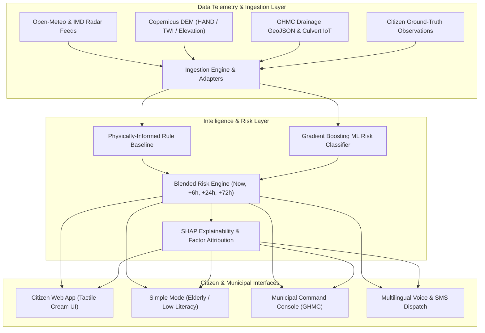

# Nirvana: Hyperlocal Climate Risk Alerts for Vulnerable Urban Communities
### Hyperlocal Climate Risk Alerts for Vulnerable Urban Communities

Nirvana is an AI-assisted, street-level flood and heat resilience platform designed for vulnerable urban populations in India. By fusing high-resolution Doppler radar, digital elevation models (SRTM/Copernicus), municipal drainage topologies, and verified crowd-sourced citizen ground-truth, Nirvana estimates neighborhood-level flood inundation depth and wet-bulb heat stress.

---

## 🏛️ System Architecture



---

## 📂 Monorepo Structure

```
├── frontend/           # Google Stitch Export Prototype (code.html, DESIGN.md, screen.png)
├── web/                # Next.js 14 App Router + Tailwind CSS + Framer Motion (Citizen & Municipal App)
│   ├── src/app/        # Root Layout, Global Styles, and Page Assembly
│   ├── src/components/ # Dual Risk Gauge, MapComponent, ShelterLocator, Reports, SimpleMode, MunicipalCommand
│   ├── src/lib/        # Multilingual i18n Dictionary, Mock Telemetry Data & Hydrology
│   └── Dockerfile      # Optimized Multi-stage Node.js container
├── api/                # FastAPI Python Backend (REST API + OpenAPI v1 + WebSockets)
│   ├── routes/         # Risk, Forecast, Alerts, Shelters, Reports, Guidance, Auth, Dashboard, Simulation
│   ├── main.py         # App entrypoint, CORS, WebSockets
│   └── Dockerfile      # Python container definition
├── ml/                 # Risk Intelligence & Machine Learning
│   ├── model.py        # FloodRiskEngine & HeatRiskEngine with SHAP Explainability
│   ├── train.py        # Model training script with Demographic Fairness & Equity audit
│   ├── synthetic_data.py # Historical complaints generator calibrated on Hyderabad 2020 deluge
│   └── MODEL_CARD.md   # Model Card (assumptions, metrics, fairness, limitations)
├── data/               # Geospatial & Hydrological Datasets
│   ├── hyderabad_wards.geojson # 22 Monitored Wards with DEM features (HAND, TWI, Musi proximity)
│   ├── drains.geojson  # Stormwater nalas & culvert condition layer
│   ├── shelters.json   # Verified vs Unverified relief shelters with live occupancy
│   └── alert_templates.json # Multilingual hazard templates (EN, HI, TE, TA)
├── infra/              # Container Orchestration & Infrastructure
│   ├── docker-compose.yml # 1-Command local execution (web, api, db, redis)
│   └── .env.example    # Complete environment variable template
├── DEMO_SCRIPT.md      # 5-Minute Walkthrough script for hackathon judges & stakeholders
├── nirvana_api.postman_collection.json # OpenAPI Postman Test Collection
└── README.md           # Master Documentation
```

---

## 🚀 Quickstart: One-Command Execution

### Option 1: Docker Compose (Recommended)
Launch the entire system (Next.js web app, FastAPI backend, PostgreSQL + PostGIS, Redis) with a single command:

```bash
docker-compose -f infra/docker-compose.yml up --build
```
- **Citizen Web App & Municipal Dashboard:** [http://localhost:3000](http://localhost:3000)
- **FastAPI Interactive Swagger Docs:** [http://localhost:8000/docs](http://localhost:8000/docs)

### Option 2: Local Developer Run

#### 1. Start the FastAPI Backend:
```bash
# Create virtual environment and install packages
python -m venv .venv
.\.venv\Scripts\activate
pip install -r api/requirements.txt

# Run the API
python -m uvicorn api.main:app --host 0.0.0.0 --port 8000 --reload
```

#### 2. Start the Next.js Frontend:
```bash
cd web
npm install
npm run dev
```

---

## 🎨 UI Implementation: The Nirvana Design System
Nirvana strictly follows the Google Stitch design guidelines:
- **Canvas Theme:** Warm, light cream/white background (`#FBF7EF` and `#FFFFFF`), strictly avoiding dark themes to promote calm, clear civic reading under direct daylight.
- **Color Tokens:**
  - Sand divider accent: `#F3EBDD`
  - Charcoal ink: `#2B2A28` (pure `#000000` is strictly avoided to prevent harsh optical vibration)
  - Civic teal: `#1F7A8C`
  - Saffron warmth: `#F28C28`
  - Semantic Risk Palette: Low (`#4CAF7A`), Moderate (`#F2B134`), High (`#EE7B30`), Severe (`#D9453D`)
- **Typography:**
  - Headings: **Plus Jakarta Sans**
  - Body & Metrics: **Inter**
  - Regional Non-Latin Scripts: **Noto Sans** with expanded line-height (`28px` on `16px` font) to avoid clipping stacked diacritics.

---

## 🌐 Onboarding a New City (City-Agnostic Architecture)
While Hyderabad is the primary pilot city with 22 seeded wards, Nirvana is designed to be onboarded in any Indian municipality:
1. **Provide Ward Boundaries:** Add your municipality's GeoJSON to `data/your_city_wards.geojson`.
2. **Compute Topographic Layers:** Process 30m Copernicus GLO-30 DEM through `pysheds` or `whitebox` to extract per-ward base elevation, Height Above Nearest Drainage (HAND), and Topographic Wetness Index (TWI).
3. **Import Storm Drains:** Query OpenStreetMap Overpass API for `waterway=drain` or import municipal GIS shapefiles into `data/drains.geojson`.
4. **Configure Local Emergency Helplines:** Update municipal disaster control room phone numbers in `api/routes/guidance.py`.

---

## 🗣️ Adding a New Regional Language
1. Add language translation keys to `web/src/lib/i18n.ts`.
2. Ensure Noto Sans typography is loaded in `web/src/app/layout.tsx`.
3. Add curated hazard templates to `data/alert_templates.json`.

---

## ⚖️ Statutory Positioning & Compliance
**Important:** Nirvana is advisory and complements, never replaces, official warnings issued by the India Meteorological Department (IMD), National Disaster Management Authority (NDMA), or State Disaster Management Authorities (SDMAs). Every risk output clearly indicates data freshness, confidence metrics, and official helpline access.
